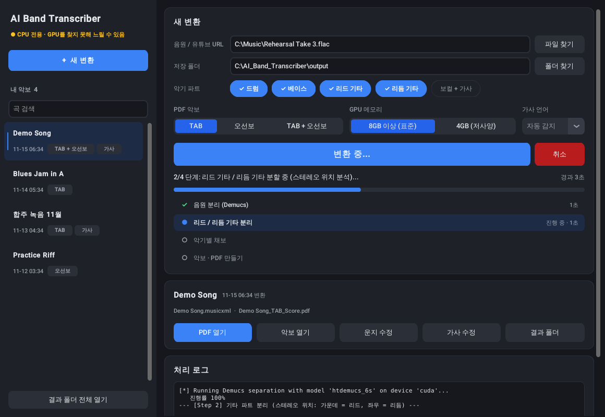
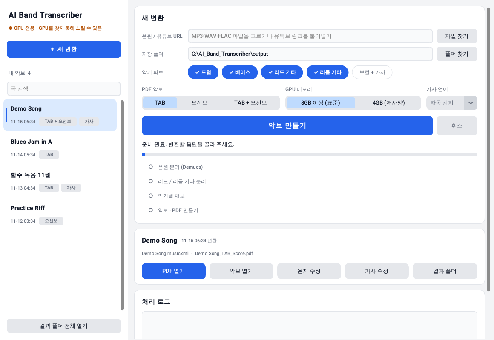
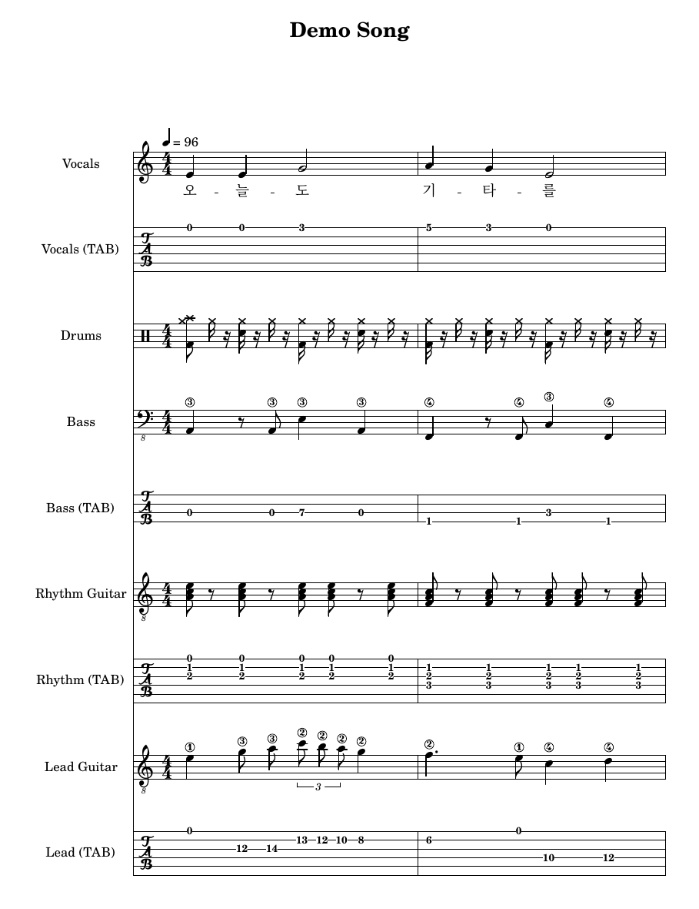
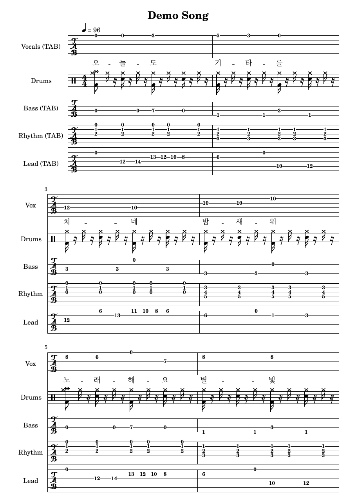
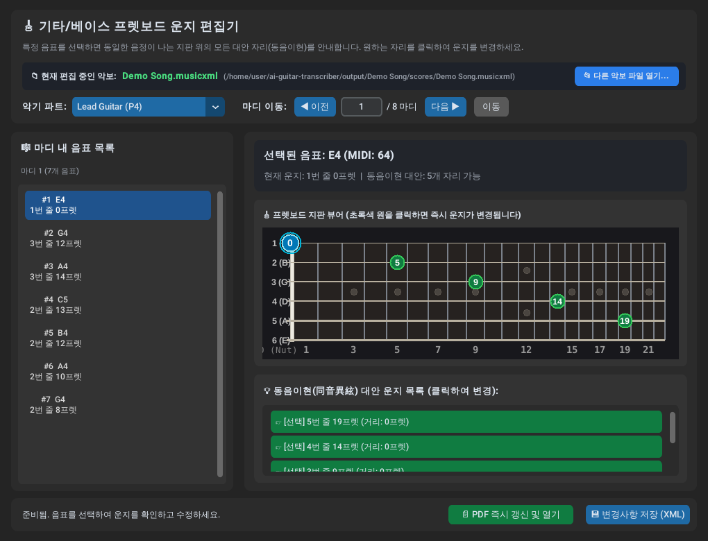
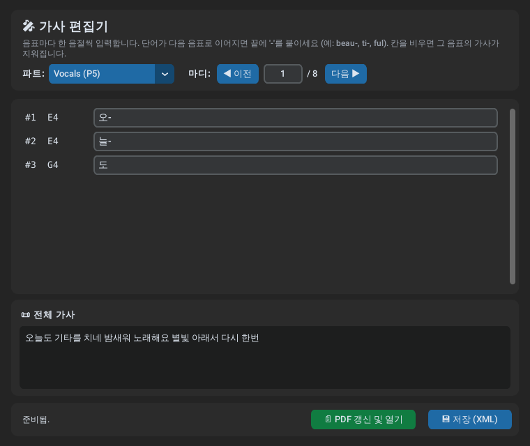

# 🎸 [v1.3.0] - 채보 정확도·박자 처리 개선, 보컬/가사 채보, 새 GUI

**AI Band Transcriber v1.3.0**은 채보 엔진 대부분을 다시 손본 업데이트입니다. 보컬 멜로디와 가사 채보가 추가됐고, 코드·드럼·기타 분리의 정확도가 올랐으며, 템포가 흔들리는 곡과 셋잇단음표·3/4박 같은 박자도 악보에 제대로 적습니다. 메인 화면은 곡 목록과 단계별 진행 표시가 있는 새 배치로 바뀌었습니다.

> 아래 수치는 모두 정답을 아는 **합성 음원**으로 잰 것입니다. 실제 곡에서는 다를 수 있고, 실제 곡 전체 처리와 GPU 실행은 자동 검증 범위에 들어 있지 않습니다.

**받는 법**: 아래 Assets의 `AI_Band_Transcriber_v1.3.0.zip`을 받아 압축을 풀고 `AI_Band_Transcriber.exe`(또는 `start.bat`)를 더블 클릭하세요. 이 zip에는 이번 버전 소스로 새로 빌드한 런처가 들어 있습니다.

---

## 📸 스크린샷

### 🖥️ 새 메인 화면: 곡 목록 · 변환 · 결과
왼쪽에 변환한 곡 목록, 오른쪽에 새 변환과 선택한 곡의 버튼이 있습니다. 변환 중에는 단계별 체크 목록과 걸린 시간이 표시되고, 언제든 취소할 수 있습니다. (곡 목록은 예시입니다.)

<div align="center">
  
</div>

Windows의 라이트/다크 설정을 그대로 따라갑니다.

<div align="center">
  
</div>

### 🎼 총보: 오선보 + TAB + 가사
보컬 멜로디와 가사, 드럼, 베이스, 리듬/리드 기타가 한 악보에 들어갑니다. 셋잇단음표와 표준 드럼 기보도 표기됩니다. (악보 생성기로 만든 짧은 예시 곡입니다.)

<div align="center">
  
</div>

### 🎸 TAB 악보

<div align="center">
  
</div>

### 🎸 가상 프렛보드 운지 편집기
음표를 고르면 같은 음이 나는 다른 줄·프렛(동음이현)을 지판에 보여 주고, 클릭 한 번으로 운지를 바꿉니다.

<div align="center">
  
</div>

### 🎤 가사 수정 창
인식된 가사를 음표마다 한 음절씩 고치고 PDF를 다시 만듭니다.

<div align="center">
  
</div>

---

## 🌟 바뀐 점 (What's New)

### 1. 🎤 보컬 멜로디 & 가사 채보 (새 기능)
- 분리된 보컬의 멜로디를 오선보와 기타 TAB으로 채보합니다. 기타가 없는 곡도 악보로 만들 수 있습니다.
- Whisper(faster-whisper)가 가사와 단어별 시간을 인식하고, 음절 단위로 쪼개 음표 아래에 붙입니다. 가사는 `<곡명>_lyrics.txt`로도 저장됩니다.
- 가사 수정 창에서 잘못 인식된 가사를 고칠 수 있습니다.

### 2. 🎸 채보 정확도
| 항목 | 이전 | v1.3.0 |
| --- | --- | --- |
| 코드 인식 정확도 | 88% | 94~99% |
| 코드: 무음 구간을 코드로 읽는 오인식 | 100% | 0% |
| 코드: 스트럼 검출 | 4/68 | 68/68 |
| 드럼 분류 F1 | 0.35 | 0.99 |
| 리드 기타 멜로디 (리드/리듬 분리 후) | 0% | 53~78% |

- **코드**: 좌우 채널을 따로 분석해, 두 테이크가 섞이며 3음이 상쇄되는 문제를 막았습니다.
- **드럼**: 주파수 대역별 어택으로 킥·스네어·하이햇(클로즈/오픈)·크래시를 구분합니다. 크래시가 울리는 동안의 하이햇도 잡고, 곡 뒤로 갈수록 타이밍이 밀리던 버그(20초에서 50ms)를 고쳤습니다.
- **리드/리듬 기타 분리**: Mid-Side 대신 스테레오 위치(센터 추출)로 나눕니다. 리듬 기타가 가운데, 솔로가 한쪽에 있는 믹스는 둘을 맞바꾸고, 모노 기타나 리드가 없는 곡도 처리합니다.
- **버그 수정**: 리듬 기타 트랙이 무음이 되던 문제, 칠 수 없는 코드 운지, 한 줄에 두 음이 겹친 TAB 화음.
- 같은 음을 다시 친 것은 나누고, 비브라토는 한 음으로 유지합니다.

### 3. 🎼 박자·템포·악보 표기
| 항목 | 이전 | v1.3.0 |
| --- | --- | --- |
| 템포가 ±8~15% 변하는 곡에서 제자리에 적힌 음표 | 24~55% | 100% |
| 템포 두 배/절반 판정 (68~190 BPM 12곡) | 6곡 정답 | 12곡 정답 |
| 셋잇단음표가 섞인 멜로디의 제자리 음표 | 78% | 98~100% |
| 셔플 리듬의 제자리 음표 | 50% | 100% |

- **박 지도**: 박 하나하나의 위치를 따라 마디선을 그어, 클릭 없이 녹음한 곡도 음표가 제 마디에 적힙니다.
- 3/4박 판정, 셋잇단음표·6연음 표기, 셔플·6/8 곡의 12/8·6/8 표기, 정말 빠른 박에서만 쓰는 32분음표.
- 마디를 넘는 음은 붙임줄로 잇고, 쉼표는 박 경계에 맞춥니다.
- MusicXML에 템포, 줄 튜닝, 옥타브 음자리표, 표준 드럼 기보, 조표 추정을 넣었습니다. MusicXML 3.1 공식 스키마 검증을 통과합니다.
- PDF 악보에서 악기 이름(`Rhythm Guitar` 등)이 왼쪽에서 잘리던 문제를 고쳤습니다.

### 4. 🖥️ 새 GUI
- **곡 목록**: 변환한 곡을 최신순으로 보여 주고 검색할 수 있습니다. 곡마다 만든 악보 종류(TAB, 오선보, 가사)가 표시됩니다.
- **단계 체크 목록**: 음원 분리 → 리드/리듬 기타 분리 → 악기별 채보 → (가사 인식) → 악보·PDF 만들기 단계의 상태와 걸린 시간을 보여 줍니다.
- **취소 버튼**: 진행 중인 단계를 바로 멈추고, 돌고 있던 음원 분리(Demucs)도 종료합니다.
- **파트 선택 버튼**, **설정 기억**(`gui_settings.json`), **Windows 라이트/다크 설정을 따르는 디자인**.
- CLI와 GUI가 같은 파이프라인을 쓰고, 곡마다 출력 폴더(`output/<곡명>/`)를 따로 만듭니다.

### 5. ⚙️ 설치·안정성
- **VRAM 8GB/4GB 모드**: 그래픽카드 용량을 감지해 기본값을 고르고, 메모리가 모자라면 더 작은 설정으로 자동 재시도합니다.
- Demucs 진행률을 실시간으로 보여 주고 멈춤을 감지합니다. LilyPond에 시간 제한을 걸었습니다.
- 예비 채보기 basic-pitch를 TensorFlow 없이 onnxruntime으로 설치해 설치가 가벼워졌습니다. 이전 버전을 쓰던 폴더에서는 `venv` 폴더를 지우고 `start.bat`을 다시 실행하면 가벼워집니다.
- GitHub Actions가 push마다 Windows에서 `start.bat` 설치, GUI 실행, 전체 테스트(74개)를 확인하고 런처 exe를 빌드합니다.

---

## ⚠️ 알려진 한계
- 실제 곡 전체 처리와 GPU(VRAM 모드, Whisper의 CUDA 실행)는 자동 검증에 들어 있지 않습니다.
- 리드/리듬 분리: 리드가 가운데에서 25% 넘게 치우치거나 리듬 기타가 가운데 가까이 있으면 잘 나뉘지 않습니다.
- 박 추적기가 8분음표를 박으로 잡는 6/8 곡은 아직 처리하지 않습니다.
- 타이밍이 크게 흔들리는 셋잇단음표는 놓칠 수 있고, 크래시 직후의 하이햇은 일부 묻힙니다.
- 가사: 랩·샤우팅·리버브가 강한 보컬은 정확도가 떨어집니다. 상업 음원의 가사가 들어간 악보는 개인 연습용으로만 쓰세요.

---

## 🚀 설치 안내 (Quick Start)

### 🎯 1. Windows 원클릭 실행
1. Assets의 `AI_Band_Transcriber_v1.3.0.zip`을 받아 압축을 풉니다. (또는 `git clone`)
2. 폴더 안의 **`AI_Band_Transcriber.exe`** (또는 **`start.bat`**)를 더블 클릭합니다.
3. 최초 1회 가상환경과 PyTorch(CUDA 가속)를 자동으로 설치한 뒤 프로그램이 실행됩니다. Python 3.10 또는 3.11이 필요합니다.

### 🛠️ 2. 필수 외부 유틸리티
```powershell
# 1. FFmpeg (오디오 변환, 유튜브 변환)
winget install Gyan.FFmpeg

# 2. LilyPond (PDF 악보 생성)
winget install LilyPond.LilyPond

# 3. MuseScore 4 (선택: MusicXML 악보 열람·재생)
winget install Musescore.Musescore
```

---

## 🏷️ 태그 및 관련 키워드
`v1.3.0`, `ai-transcription`, `guitar-tab`, `torchcrepe`, `demucs`, `chord-recognition`, `drum-transcription`, `lyrics-transcription`, `whisper`, `fretboard-editor`, `musicxml`, `lilypond`, `musescore`, `customtkinter`, `pytorch`, `audio-to-tab`
