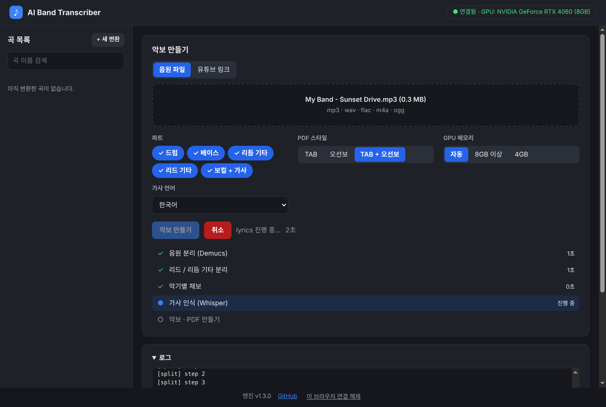
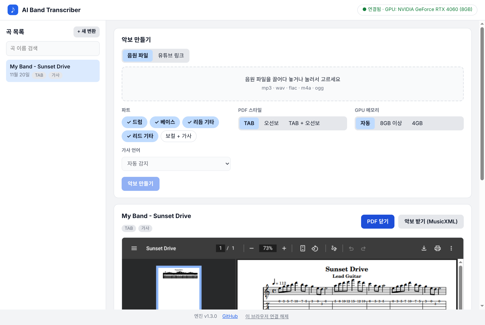
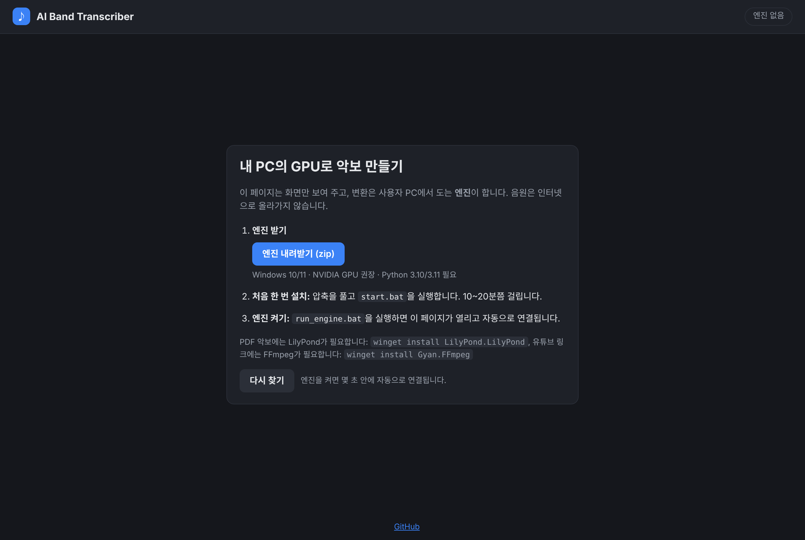

# 🌐 [v1.4.0] - 웹페이지에서 쓰기 (변환은 내 PC의 GPU로)

**AI Band Transcriber v1.4.0**부터는 웹페이지에서 악보를 만들 수 있습니다. 화면은 웹에서 보고, 변환은 내 PC에서 도는 **엔진**이 내 GPU로 합니다. 음원은 인터넷으로 올라가지 않고 내 PC 안에서만 오갑니다.

- **웹페이지:** https://manofkimchi08.github.io/ai-guitar-transcriber/
- **받는 법:** 아래 Assets의 `AI_Band_Transcriber_v1.4.0.zip`을 받아 압축을 풉니다. 처음 한 번 `start.bat`으로 설치하고, `run_engine.bat`을 실행하면 웹페이지가 열리며 자동으로 연결됩니다. 데스크톱 GUI(`AI_Band_Transcriber.exe`)도 그대로 쓸 수 있습니다.

> 웹페이지와 엔진은 가짜 변환으로 브라우저에서 자동 점검했습니다. 실제 GPU로 끝까지 변환하는 것과 배포된 사이트에서의 접속은 자동 검증 범위에 들어 있지 않습니다.

---

## 📸 스크린샷

### 🌐 웹페이지: 변환 중
파트, PDF 스타일, GPU 메모리, 가사 언어를 고르고 [악보 만들기]를 누르면 단계별 진행과 걸린 시간이 보입니다. 위쪽에는 연결된 엔진과 GPU가 표시됩니다.

<div align="center">
  
</div>

### 📄 웹페이지: 곡 목록과 PDF 미리보기
변환한 곡을 고르면 페이지 안에서 PDF를 바로 보고 MusicXML, MIDI, 분리된 음원을 받을 수 있습니다. 시스템의 라이트/다크 설정을 따릅니다. (예시 악보입니다.)

<div align="center">
  
</div>

### 🧩 엔진이 없을 때
내 PC에 엔진이 없으면 내려받기 버튼과 설치 순서를 보여 주고, 엔진을 켜면 몇 초 안에 저절로 연결 화면으로 넘어갑니다.

<div align="center">
  
</div>

---

## 🌟 바뀐 점 (What's New)

### 1. 🌐 웹페이지 (`web/`, GitHub Pages)
- 음원 파일(끌어다 놓기) 또는 유튜브 링크로 변환하고, 업로드 진행 막대와 단계별 체크 목록, 취소, 로그를 보여 줍니다.
- 곡 목록과 검색, 태그(TAB / 오선보 / 가사), 페이지 안 PDF 미리보기, 결과 파일 받기.
- 고른 옵션을 기억하고, 새로 고쳐도 진행 중인 변환을 다시 따라갑니다. 엔진이 꺼지면 알려 주고 다시 켜지면 저절로 이어집니다.
- 데스크톱 GUI와 같은 색을 쓰고 시스템 라이트/다크 설정을 따릅니다.

### 2. 🖥️ 로컬 엔진 (`engine.py`, `run_engine.bat`)
- 내 PC에서 `127.0.0.1:51823`으로만 요청을 받는 작은 서버입니다. 새로 설치할 패키지는 없습니다.
- 한 번에 한 곡씩 변환하고, 결과는 데스크톱 GUI와 같은 `output/` 폴더에 저장되어 두 화면에서 같은 곡 목록을 봅니다.
- API 설명: [`docs/engine_api.md`](https://github.com/ManofKimchi08/ai-guitar-transcriber/blob/v1.4.0/docs/engine_api.md)

### 3. 🔒 보안
- 허용한 사이트(이 웹페이지)에서 온 요청만 받고, 다른 사이트는 엔진의 응답을 읽을 수 없습니다. DNS 리바인딩도 막습니다.
- 브라우저마다 처음 한 번 엔진 창의 **연결 코드**(6자리)로 연결합니다. 코드는 한 번만 쓸 수 있고 5번 틀리면 바뀝니다. 모든 연결을 끊으려면 `run_engine.bat --reset-token`.

### 4. ⚙️ 자동 점검
- Windows CI가 실제로 설치한 환경에서 엔진을 켜고 응답을 확인합니다. 엔진 테스트 13개가 추가되어 Windows에서 테스트 87개가 통과합니다.
- 브라우저 점검(Chromium): 연결, 업로드와 변환, 취소, 새로 고침 후 이어 보기, 엔진 재시작 복구, 다른 사이트 차단 등 23개 항목.

---

## ⚠️ 알려진 한계
- 실제 곡 전체 처리와 GPU 실행은 자동 검증에 들어 있지 않습니다.
- 크롬·엣지를 권장합니다. 크롬이 "이 기기의 다른 앱 및 서비스에 액세스" 권한을 물으면 허용하세요. 사파리는 내 PC의 엔진에 접속하지 못할 수 있습니다.
- 엔진은 아직 콘솔 창으로 뜹니다(트레이 아이콘, 원클릭 설치기는 다음 단계). 서명되지 않은 파일이라 Windows가 경고를 띄울 수 있습니다.
- 운지·가사 수정은 아직 데스크톱 GUI에서만 할 수 있습니다.
- v1.3.0의 한계(리드/리듬 분리, 6/8 박 추적, 가사 인식 정확도)는 그대로입니다.

---

## 🚀 설치 안내 (Quick Start)

### 🌐 1. 웹페이지로 쓰기
1. Assets의 `AI_Band_Transcriber_v1.4.0.zip`을 받아 압축을 풉니다.
2. 처음 한 번 **`start.bat`**을 실행해 설치합니다(10~20분, Python 3.10 또는 3.11 필요). 설치가 끝나면 데스크톱 GUI가 열리는데 닫아도 됩니다.
3. **`run_engine.bat`**을 실행하면 웹페이지가 열리고 자동으로 연결됩니다.

### 🖥️ 2. 데스크톱 GUI로 쓰기
폴더 안의 **`AI_Band_Transcriber.exe`** (또는 `start.bat`)를 더블 클릭합니다.

### 🛠️ 3. 필수 외부 유틸리티
```powershell
# 1. FFmpeg (오디오 변환, 유튜브 변환)
winget install Gyan.FFmpeg

# 2. LilyPond (PDF 악보 생성)
winget install LilyPond.LilyPond

# 3. MuseScore 4 (선택: MusicXML 악보 열람·재생)
winget install Musescore.Musescore
```

---

## 🏷️ 태그 및 관련 키워드
`v1.4.0`, `web-app`, `local-engine`, `github-pages`, `ai-transcription`, `guitar-tab`, `demucs`, `whisper`, `musicxml`, `lilypond`, `pytorch`, `audio-to-tab`
